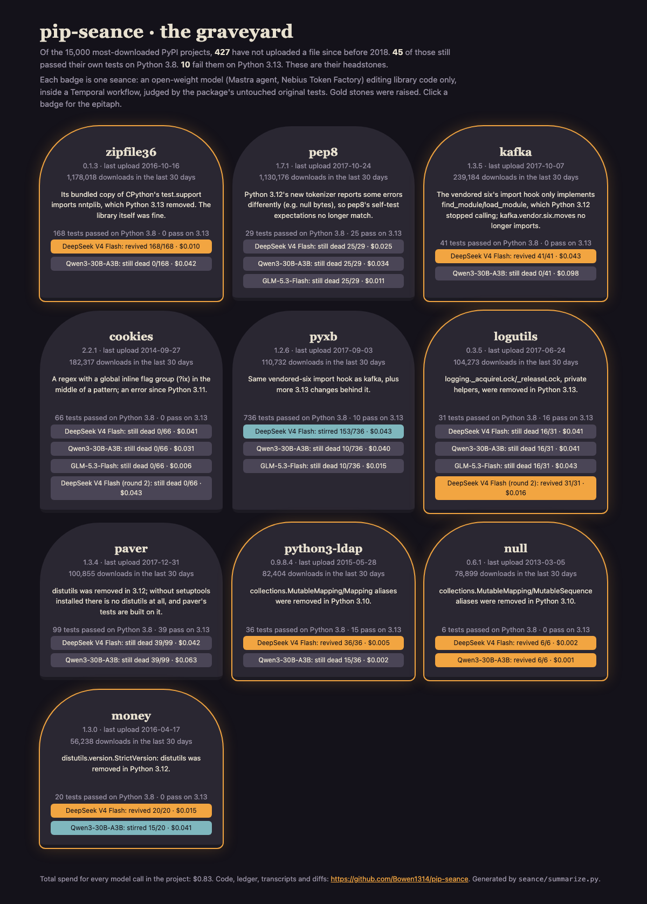

# pip-seance

**Raising abandoned PyPI packages from the dead with open-weight models.**

Hundreds of packages on PyPI have not had a release in eight years and are still downloaded
hundreds of thousands of times a month. Some of them quietly died when Python moved on: their own
test suite passed on Python 3.8 and fails on Python 3.13. pip-seance finds those ghosts, then holds
a seance for each one: a [Mastra](https://mastra.ai) agent running an open-weight model edits the
library code (never the tests) inside a [Temporal](https://temporal.io) workflow, and the package's
untouched original tests decide whether it rose.

**The graveyard (live page): https://bowen1314.github.io/pip-seance/**



## Results

Run on 27 October 2026. Full table with every run: [`results/SUMMARY.md`](results/SUMMARY.md).

**The census.** Of the 15,000 most-downloaded PyPI projects
([hugovk/top-pypi-packages](https://hugovk.dev/top-pypi-packages/), 30-day window), **427** have not
uploaded a file since before 2018. 245 of those don't ship their tests in the sdist, 109 couldn't
pass at least 3 of their own tests on Python 3.8 with only pytest, mock and six installed, 16 have
C/Cython code, 12 have no sdist. **45** pass their own tests on Python 3.8. On Python 3.13, 35 of
those still pass and **10 don't**. Those ten are the ghosts:

| ghost | last upload | downloads, 30 days | cause of death |
|---|---|---|---|
| zipfile36 | 2016-10-16 | 1,178,018 | bundled `test.support` imports `nntplib` (removed in 3.13) |
| pep8 | 2017-10-24 | 1,130,176 | 3.12's tokenizer reports some errors differently |
| kafka | 2017-10-07 | 239,184 | vendored `six` import hook (no `find_spec`, 3.12) |
| cookies | 2014-09-27 | 182,317 | global inline regex flag mid-pattern (error since 3.11) |
| pyxb | 2017-09-03 | 110,732 | vendored `six` import hook, and more |
| logutils | 2017-06-24 | 104,273 | `logging._acquireLock` removed (3.13) |
| paver | 2017-12-31 | 100,855 | `distutils` removed (3.12) |
| python3-ldap | 2015-05-28 | 82,404 | `collections.MutableMapping` removed (3.10) |
| null | 2013-03-05 | 78,899 | `collections.MutableMapping` removed (3.10) |
| money | 2016-04-17 | 56,238 | `distutils.version` removed (3.12) |

**The seances.** One run per model per ghost, $0.04 cap per run:

| medium (open-weight model on Nebius) | ghosts | raised | sound on review | left 3.8 broken | cost |
|---|---|---|---|---|---|
| DeepSeek V4 Flash | 10 | **5** | 3 | 2 | $0.266 |
| Qwen3-30B-A3B-Instruct-2507 | 10 | 1 | 1 | 1 | $0.393 |
| GLM-5.3-Flash | 4 (the hardest) | 0 | 0 | 0 | $0.075 |
| DeepSeek V4 Flash, round 2 (better test feedback) | 2 | 1 | 0 | 1 | $0.059 |

"Raised" means every target test (every test that passed on 3.8) passes on 3.13 and no protected
file changed. "Sound on review" is my own read of each diff, recorded in
[`results/audit.json`](results/audit.json). Every seance's epitaph, diff and transcript is in
[`results/runs/`](results/runs/).

What the numbers say:

- **Six of ten ghosts were raised**, five in the main bench (zipfile36, kafka, python3-ldap, null,
  money) and logutils in round 2. Every raised package still passes its tests on Python 3.8.
- **Passing tests is not the same as a good fix.** Three revivals I'd merge as they are (kafka's
  is the same shape as the fix `six` itself shipped in 1.16.0). The other three work with a
  caveat: money's fallback leans on `packaging`, which is only importable because pytest depends
  on it; logutils re-creates private functions on the stdlib `logging` module; and zipfile36 was
  never dead at all. Its bundled copy of CPython's `test.support` imports `nntplib`, and the
  "revival" is a 27-line `nntplib.py` stub.
- **A failed seance can leave the body worse.** Four runs (three in the bench, one in round 2)
  left code that no longer passes on Python 3.8 either. On cookies, DeepSeek found the cure (turn
  `(?ix)` into a scoped `(?ix:...)` group), opened the parenthesis, and spent the rest of its budget
  failing to close it: 8 of its 9 edits were rejected because the text it quoted wasn't in the
  file. It kept indenting the code by two extra spaces; my guess is it counted the two-space gutter
  after `read_file`'s line numbers. Seances work on a copy, so nothing real was harmed.
- **The agent is only as good as what it sees.** In the first bench, logutils' real error
  (`AttributeError: module 'logging' has no attribute '_acquireLock'`) was hidden: my `run_tests`
  tool led with an unrelated `No module named 'redis'` from a test that was never a target, and the
  useful line was cut from the tail. None of the three models found it before its budget ran out,
  and none of them edited a single file. After I made `run_tests` list each
  failing target with its own error message, DeepSeek raised logutils in 10 steps for $0.016.
- **The kill switch didn't kill, at first.** The per-run cap called `abort()` from Mastra's
  `onStepFinish`, and the loop kept going: one Qwen run reached $0.098 against a $0.04 cap. The cap
  is now a `stopWhen` condition and every tool refuses work once the run is over budget. A test
  with a $0.004 cap stopped at $0.0045, one step over.
- **GLM-5.3-Flash never got to speak.** It is a reasoning model, and in three of its four runs it
  spent the whole 4,096-token output budget thinking and ended with an empty reply. That row says
  more about my `maxOutputTokens` than about GLM.

**Durability.** In the chaos test, `scripts/chaos_job.sh` SIGKILLed the Temporal worker after the
agent's fourth model call. A second worker was started 10 seconds later. Temporal noticed the missing
heartbeat (90 s timeout), retried the seance activity on the new worker 89 seconds after the kill,
which continued in the
same workspace, and money rose 20/20 on attempt 2. The event history is in
[`results/runs/chaos-deepseek-v4-flash-money/`](results/runs/chaos-deepseek-v4-flash-money/).

**Spend.** Every model call in the project, including smoke, cap and chaos tests, is in
[`ledger/spend.jsonl`](ledger/spend.jsonl): **$0.83** over 523 calls, against a $1.00 cap set
before starting. Input tokens are charged at the full list price, so the real bill is at most this.

## How it works

```
seance/find_ghosts.py   top 15,000 PyPI projects -> PyPI JSON API -> last upload before 2018 = undead
seance/probe.py         download sdist (sha256 checked), run its own tests on 3.8 and 3.13 -> ghosts
agent/src/workflows.ts  Temporal workflow per (ghost, model): prepare -> seance -> verify -> epitaph
agent/src/medium.ts     the Mastra agent, model "nebius/<open-weight model>", live cost meter
agent/src/tools.ts      list_files, read_file, search, edit_file, write_file, run_tests (jailed, tests read-only)
seance/verify.py        the judge: original tests on 3.13 and 3.8, protected-file hashes
seance/replay.py        re-applies every diff to a pristine copy and re-runs the judge, $0
seance/summarize.py     SUMMARY.md, the chart, the graveyard page
```

- **The oracle.** "Target tests" are the tests that passed on Python 3.8 with the pristine sdist.
  The same pytest 8.3.5 runs both interpreters, nothing is pip-installed, the source tree is on
  `PYTHONPATH`. A small pytest plugin, [`seance/shim/seance_shim.py`](seance/shim/seance_shim.py),
  puts back unittest spellings that 3.12 deleted (`assertEquals`, `makeSuite`, ...) in every run,
  before and after, so a test file's old spelling isn't counted as the library being dead.
- **Read-only judge.** Test files, anything under `test/`/`tests/`, `conftest.py`, and
  `setup.cfg`/`tox.ini`/`pytest.ini`/`pyproject.toml` can be read but not written by the agent, and
  the verify step hashes them against the pristine copy.
- **The medium.** A Mastra `Agent` with six tools and a short brief. The model is addressed
  through Mastra's model router as `nebius/<model id>`; Mastra reads `NEBIUS_API_KEY` itself.
  Each step's token usage is priced (live prices from Nebius `/v1/models`) and appended to the
  ledger the moment the step ends, so a killed worker still leaves an exact bill.
- **Durability.** The agent loop runs inside a Temporal activity that heartbeats every 20 seconds.
  If the worker dies, Temporal retries the activity elsewhere (up to 3 attempts); the workspace and
  the ledger survive, and the medium is told an earlier attempt was interrupted.

## Reproduce

Needs Python 3.12+, Node 20+, [uv](https://docs.astral.sh/uv/), the
[Temporal CLI](https://docs.temporal.io/cli) and a Nebius Token Factory key. Linux or macOS. The
seances execute old packages' code and tests, so run them somewhere disposable; mine ran as Slurm
jobs on a university cluster.

```sh
scripts/setup_envs.sh                                   # CPython 3.8 + 3.13 venvs with pytest 8.3.5, mock, six
python3 seance/find_ghosts.py --out data/undead.jsonl   # ~15k PyPI JSON requests, a few minutes
cd seance && python3 probe.py --undead ../data/undead.jsonl --out ../data/probe.jsonl --work ../work \
    --py38 "$PWD/../envs/py38/bin/python" --py313 "$PWD/../envs/py313/bin/python" && cd ..
python3 seance/ghosts.py --probe 'data/probe*.jsonl' --undead data/undead.jsonl --out results/
(cd agent && npm ci)
export NEBIUS_API_KEY=...                                # never written to disk by this project
scripts/seance_job.sh --models deepseek-v4-flash --projects money --tag try   # one seance
scripts/chaos_job.sh deepseek-v4-flash money 4                                 # kill the worker mid-seance
```

Check every recorded number without calling a model (needs `work/pristine/`, which `probe.py`
creates):

```sh
python3 seance/replay.py --runs results/runs --work work --py38 "$PWD/envs/py38/bin/python" --py313 "$PWD/envs/py313/bin/python"
```

On 27 October all 29 runs replayed with identical numbers ([`results/replay.log`](results/replay.log), `mismatches: 0`).
Note that the census depends on the day: the download list and PyPI change over time.

## Caveats

- One run per model per ghost: anecdotes with receipts, not a benchmark.
- Round 2 used a better `run_tests` tool than the bench and only ran on two ghosts, so it is
  reported separately and not mixed into the bench numbers.
- The test environment has only pytest, mock and six. That is what excluded 109 packages, and it
  makes paver harder than in real life (with setuptools installed, `distutils` still imports).
- Results, transcripts and test output had cluster paths and host names replaced by placeholders
  ([`seance/redact.py`](seance/redact.py)). Nothing else was edited.

## Credits

- Package list: [hugovk/top-pypi-packages](https://github.com/hugovk/top-pypi-packages) (built
  from PyPI's public BigQuery download data). Package metadata and sdists: PyPI's JSON API.
- [Mastra](https://github.com/mastra-ai/mastra) (Apache-2.0) for the agent and its Nebius model
  routing; [Temporal](https://github.com/temporalio) (MIT) for the workflow, worker and dev server.
- Open-weight models served by [Nebius Token Factory](https://tokenfactory.nebius.com/).
- The per-step spend ledger and the "refuse to start a run that could cross the total cap" guard
  follow the approach of my earlier project
  [nightshift-sloth](https://github.com/Bowen1314/nightshift-sloth); the code here was written new.

Everything in this repository was written on 27 October 2026, during the DEV Hacktoberfest 2026
Week 4 challenge. MIT licensed.
